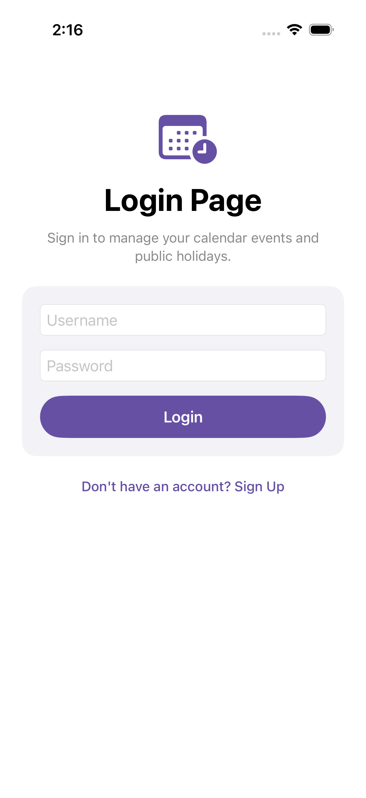
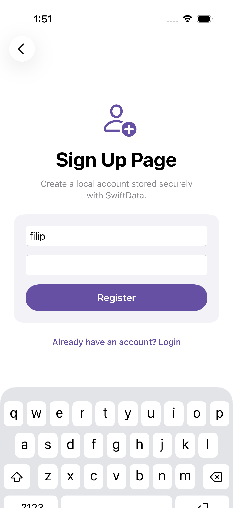
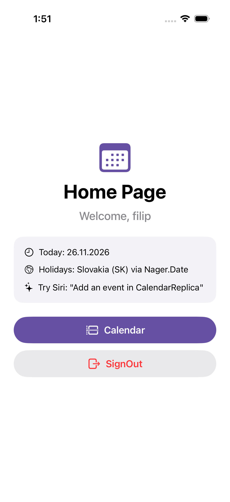
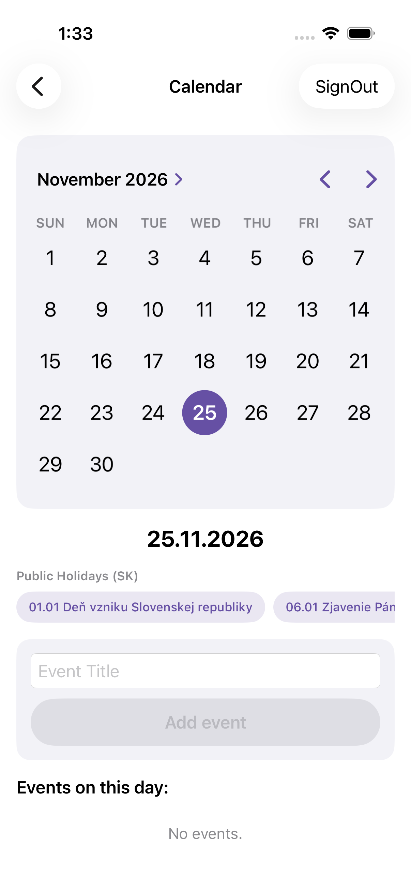
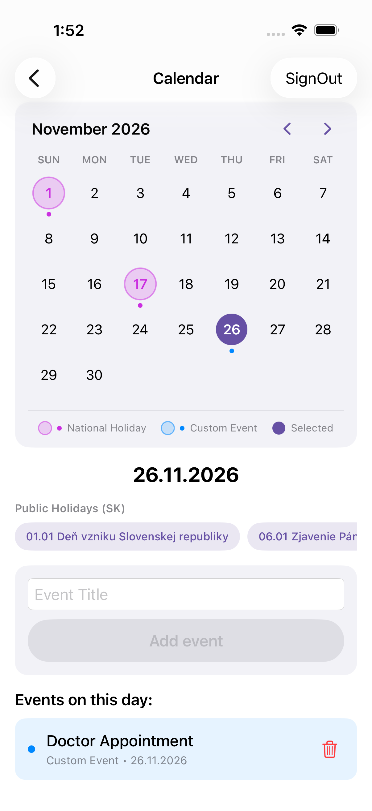
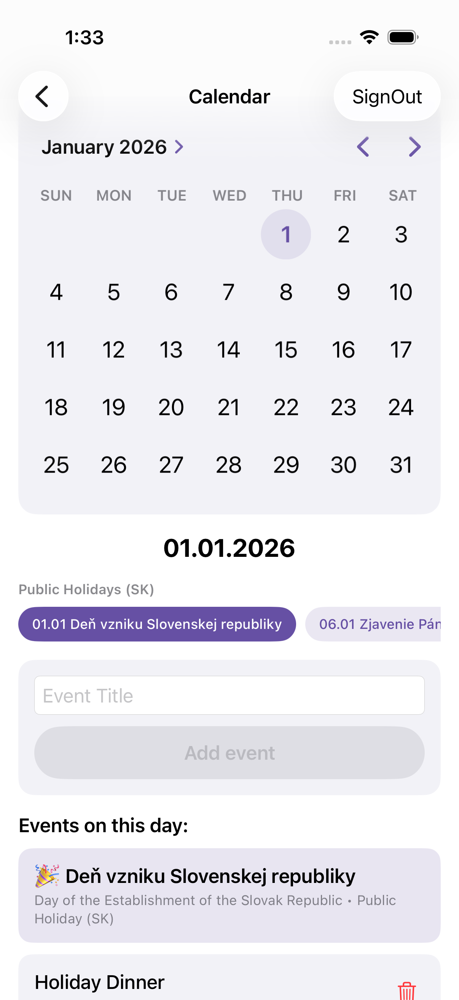
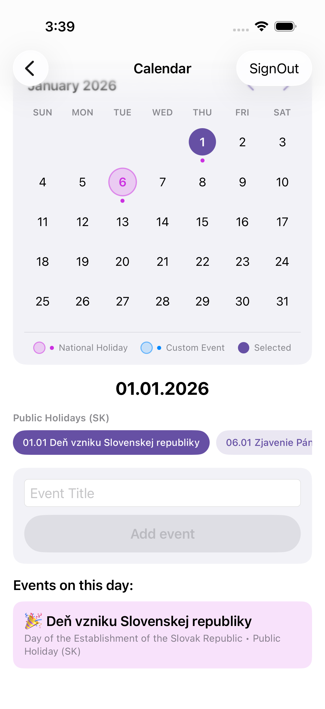

# CalendarReplica (iOS SwiftUI)

An iOS SwiftUI replica of the Android [MobilneProjekt](https://github.com/filiP9519/MobilneProjekt) calendar and public holidays application (`Test_restAPI` / `origin/TestApi`), built to satisfy the semester project requirements for Apple mobile technologies.

## Semester Project Requirements Checklist

- **SwiftUI**: Complete 4-screen UI (`LoginView`, `RegisterView`, `HomeView`, `CalendarView`) inside a declarative `NavigationStack` architecture (`RootNavigationView`).
- **`@Observable`**: `AuthViewModel` and `CalendarViewModel` use the iOS 17+ `@Observable` macro (`Observation` framework) with `@Environment(...)`.
- **SwiftData**: Persistent local storage using `@Model` classes (`UserModel` with `@Attribute(.unique)` and cascade relationship, and `CalendarEvent` scoped by owner and date key).
- **App Intents**: `AddCalendarEventIntent`, `GetDayOverviewIntent`, and `CalendarAppShortcuts` (`AppShortcutsProvider`) for Siri & Apple Shortcuts integration.

## Android (`MobilneProjekt`) to iOS (`CalendarReplica`) Mapping

| Android (`MobilneProjekt`) | Apple iOS (`CalendarReplica`) |
| --- | --- |
| Jetpack Compose (`LoginScreen`, `RegisterScreen`, `HomeScreen`, `CalendarScreen`) | SwiftUI (`LoginView`, `RegisterView`, `HomeView`, `CalendarView`) |
| `NavHost` / `Navigation.kt` | `NavigationStack` in `RootNavigationView.swift` |
| `ViewModel` + `StateFlow` (`AuthViewModel`, `CalendarViewModel`) | `@Observable` (`AuthViewModel`, `CalendarViewModel`) |
| Room Database (`UserEntity`, `EventEntity`, `AppDatabase`, `Repository`) | SwiftData (`UserModel`, `CalendarEvent`, `SharedModelContainer`, `CalendarRepository`) |
| Retrofit (`HolidayApi`, `RetrofitInstance`) | `URLSession` + `Codable` (`NagerHolidayAPIService`) |
| Nager.Date Public Holidays API (`/api/v3/PublicHolidays/{year}/SK`) | Same Nager.Date Public Holidays REST API with per-year caching & quick-jump chips |
| — | `AppIntents` (`AddCalendarEventIntent`, `GetDayOverviewIntent`, `CalendarAppShortcuts`) |

## Project Structure

- `CalendarReplica/App/` — App entry point (`CalendarReplicaApp.swift`) & `SharedModelContainer.swift`
- `CalendarReplica/Models/` — SwiftData `@Model` entities (`UserModel`, `CalendarEvent`) & `Holiday` API model
- `CalendarReplica/Services/` — `HolidayAPIService.swift`, `CalendarRepository.swift`, `DateFormatting.swift`
- `CalendarReplica/ViewModels/` — `@Observable` `AuthViewModel` and `CalendarViewModel`
- `CalendarReplica/Views/` — SwiftUI views and navigation
- `CalendarReplica/Intents/` — `AppIntent` definitions & `AppShortcutsProvider`
- `CalendarReplicaTests/` — Unit & live API & App Intent tests
- `CalendarReplicaUITests/` — End-to-end XCUITest verifying navigation, API holidays, custom events, deletion, and persistence
- `.github/workflows/ios-ci.yml` — Automated Xcode 16 + iOS Simulator CI pipeline

## Opening & Running in Xcode

1. Open `CalendarReplica.xcodeproj` directly in Xcode 16+ (or regenerate it via `xcodegen generate` from `project.yml`).
2. Select the `CalendarReplica` scheme and any iOS 17+ / 18+ Simulator.
3. Run the app (`Cmd+R`) or run all unit and UI tests (`Cmd+U`).

## Automated Verification & Proof

Every push to `main` runs the full unit test suite (including live Nager.Date API & App Intent tests) and end-to-end XCUITest suite on a `macos-15` iOS Simulator via GitHub Actions:

- Full test report: [`docs/TEST_REPORT.md`](docs/TEST_REPORT.md)

### Simulator Screenshots

| Login Screen | Sign Up Screen | Home Screen | Calendar & Live API Chips |
| --- | --- | --- | --- |
|  |  |  |  |

| Custom Event Added | API Holiday + Custom Event | After Event Deletion | Signed Out |
| --- | --- | --- | --- |
|  |  |  |  |
